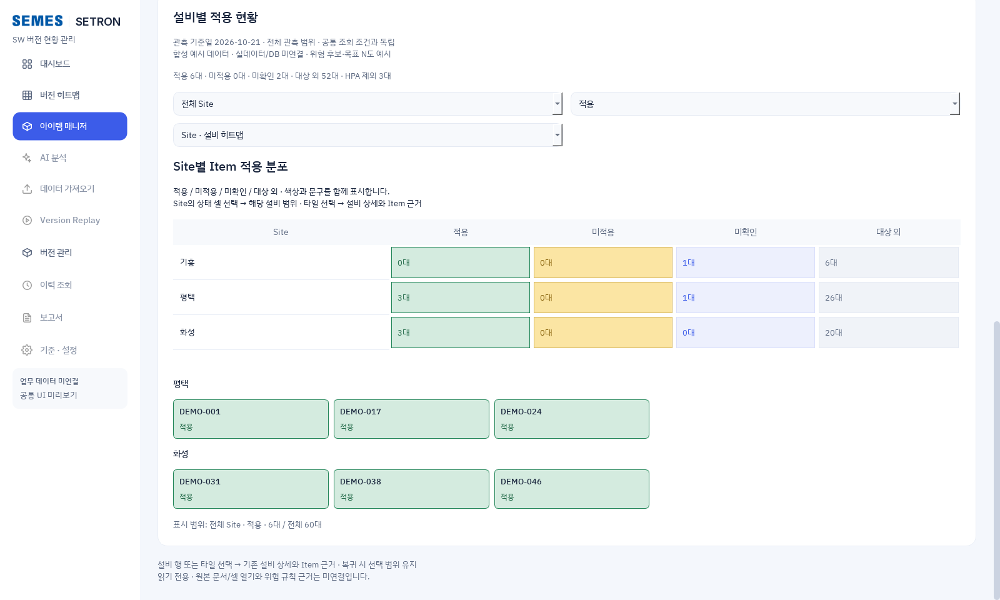
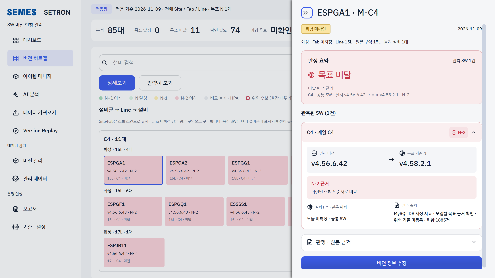
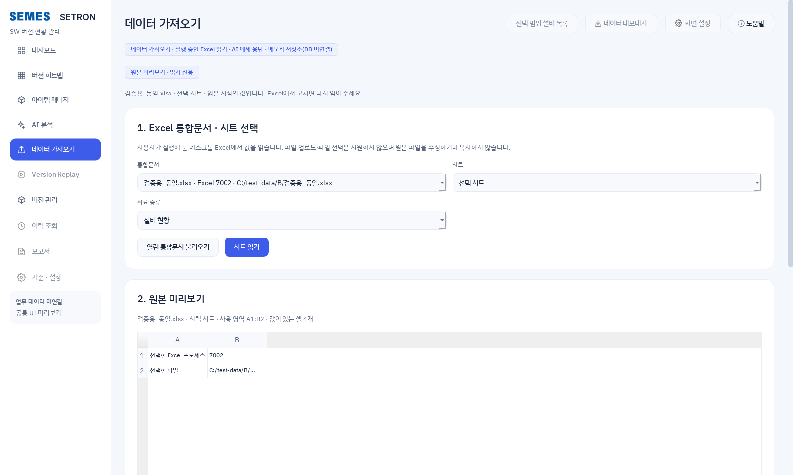
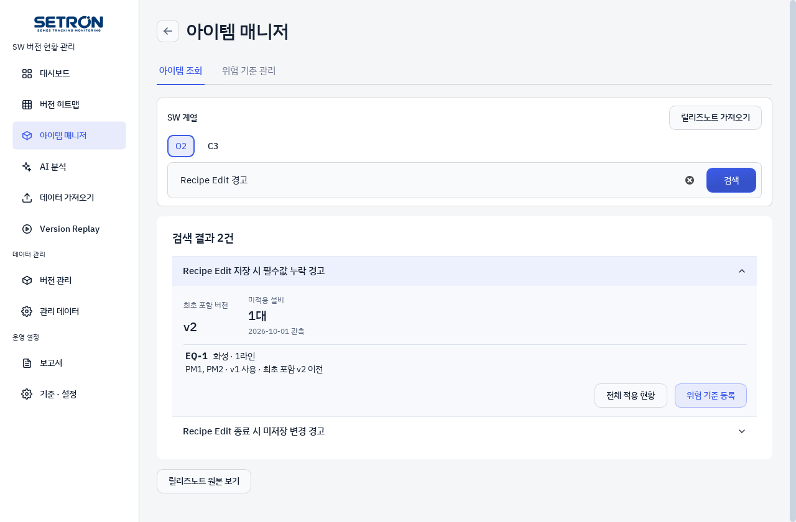

# SETRON

**AI 기반 SW Version 분포 Heatmap 솔루션**

반도체 장비 제조사 SEMES의 설비 소프트웨어 버전을 한눈에 보고, 업데이트 대상을 찾고, 자연어로 분석하는 Windows 데스크톱 애플리케이션입니다.
SSAFY 15기 기업연계 프로젝트(SEMES SW CS그룹)로 2026년 10월 20일부터 11월 18일까지 개발했습니다.

---

## 왜 만들었나

설비 SW 버전 현황은 Excel 현황표와 릴리즈 노트에 흩어져 있어 "어느 라인의 어떤 설비가 몇 단계 뒤처져 있는지"를 파악하려면 매번 수작업 정리가 필요했습니다.
SETRON은 이 과정을 다음 흐름으로 바꿉니다.

```
열린 Excel 현황표 ─► 규칙 추출 또는 AI 추출 ─► 사람이 검토·수정(HITL) ─► MySQL 저장
                                                                          │
      보고서(Word/PDF) ◄─ AI 분석(자연어 질의) ◄─ 히트맵 · 대시보드 · 리플레이 ◄─┘
```

AI가 읽은 값은 원본 셀과 대조한 뒤 사람이 검토해야만 저장되고, 집계 숫자는 항상 DB가 계산합니다. AI 응답이 달라져도 저장 자료와 지표는 바뀌지 않습니다.

---

## 주요 기능

기업 요구사항 6개를 모두 구현했고, 보고서 화면을 추가했습니다.

| # | 요구사항 | 화면 | 핵심 |
| --- | --- | --- | --- |
| ① | 대시보드 | 대시보드 | 목표 N 달성률 · 분석 대상 · 목표 미달 · 확인 필요 · 위험 후보 KPI 5종, 히트맵/원형/막대/꺾은선 보기 |
| ② | Version HeatMap | 버전 히트맵 | 사업장–라인–설비군–설비 격자, 상대 버전(N · N-1 · N-2…) ↔ 실제 버전 전환, 설비 상세와 판정 근거 |
| ③ | Excel Import/Export | 데이터 가져오기 · 내보내기 | 실행 중인 Excel 창에서 직접 읽기, 규칙/AI 추출, 원본 셀 추적, 검토 후 저장, 현황 Excel · SQL 백업 출력 |
| ④ | Item 관리 | 아이템 매니저 | 릴리즈 Item 검색, 설비별 적용/미적용 현황, 위험 기준 등록 |
| ⑤ | AI 분석 | AI분석 | 자연어 질의 → 조회 조건 해석, 통일률 · 위험도 · 예측 분석, 판단 근거 표시, 보고서 저장 |
| ⑥ | Version Replay | 버전 리플레이 | 기준일 순서로 버전 분포 변화를 재생, 임의 시점 이동 |
| + | 보고서 | 보고서 | 요약 · 적용률 추이 · 히트맵 · 위험 근거를 조립해 Word/PDF 생성 |

### 화면

| 버전 히트맵 | 대시보드 |
| --- | --- |
|  |  |

| Excel 가져오기 | 아이템 매니저 |
| --- | --- |
|  |  |

---

## 기술 스택

| 구분 | 기술 | 비고 |
| --- | --- | --- |
| 언어 | Python 3.13 | `uv`로 의존성 고정 (`uv.lock`) |
| GUI | PySide6 6.12 | 화면 모듈 약 110개, 다크/라이트 테마 |
| DB | MySQL 5.6.19 + SQLAlchemy / PyMySQL | 고객사 환경 버전에 맞춤. 테이블 13개 |
| Excel | xlwings (COM) / pandas / openpyxl | 열려 있는 Excel에서 읽고, XLSX로 내보냄 |
| AI | openai SDK (OpenAI 호환 API) | `base_url`만 바꿔 GMS ↔ 사내 서버 전환 |
| 보고서 | python-docx | Word · PDF |
| 테스트 | pytest | 테스트 파일 340여 개, MySQL 통합 테스트 포함 |
| 배포 | PyInstaller | Python 없이 실행하는 `SETRON.exe` |
| 개발 DB | Docker Compose | MySQL 5.6.19 이미지 직접 빌드 |

---

## 아키텍처

화면(`ui/`), 업무 로직(`features/`), 외부 연동(`infrastructure/`)을 분리했습니다. 업무 로직은 Qt에 의존하지 않고, 화면은 DB를 직접 호출하지 않습니다.

```text
src/setron/
├── __main__.py          # 실행 진입점
├── ui/                  # PySide6 화면 (대시보드 · 히트맵 · 리플레이 · 아이템 · AI · 가져오기 · 보고서 · 설정)
├── features/            # 업무 로직 28개 패키지
│   ├── excel_import/ rule_extraction/ extraction/ import_save/   # Excel → 검토 → 저장
│   ├── version/ aggregation/ targets/ history/                    # 버전 비교 · N 단계 · 집계
│   ├── risk/ aging/ priority/ forecast/                           # 위험 · 노후도 · 우선순위 · 예측
│   ├── ai/ chat/ analysis/ report/                                # 자연어 해석 · 분석 · 보고서
│   └── item/ release/ equipment/ export/ db_export/ db_import/ … 
└── infrastructure/
    ├── database.py      # 접속 · 트랜잭션 · 오류 구분
    ├── ai_client.py     # OpenAI 호환 클라이언트 (설정 없으면 예제 응답)
    └── excel_reader.py  # 열린 Excel 창 읽기
```

| 폴더 | 내용 |
| --- | --- |
| `database/` | 스키마(`schema_mysql5619.sql`), 시연 시드(설비 300대 · 관측 1,800건), DB 준비 스크립트 |
| `packaging/` | Windows 실행 파일 빌드(`build_windows.ps1`, `setron.spec`) |
| `tests/` | pytest 테스트 |
| `docs/` | 화면별 설계 문서, 아키텍처, 테스트 결과 |
| `exec/` | 포팅 매뉴얼, 외부 서비스, DB 덤프, 시연 시나리오 |
| `ai/` | 데이터·AI 파트 실험 폴더 (파서 · 매칭 · 위험 · 예측 프로토타입) |

### 설계에서 신경 쓴 점

- **상대 버전(N 단계)**: 설비군마다 "목표 N"을 두고, 각 설비를 N / N-1 / N-2 이하로 판정합니다. 목표가 바뀌면 전체 판정이 다시 계산되고 이력이 남습니다.
- **HITL 가져오기**: AI 추출 결과를 원본 셀 주소와 함께 보여 주고, 원본과 다른 값은 검토 대상으로 표시합니다. 저장은 사람이 확인한 뒤에만 일어납니다.
- **AI 교체 가능성**: 고객사 사내 AI 서버가 OpenAI 호환이라는 조건에 맞춰, 환경변수 4개(`SETRON_AI_BASE_URL` · `API_KEY` · `MODEL` · `TIMEOUT`)만 바꾸면 코드 수정 없이 전환됩니다.
- **오프라인 동작**: DB나 AI 설정이 없어도 합성 예시 자료와 예제 응답으로 모든 화면이 열립니다.
- **백그라운드 처리**: DB 읽기와 AI 호출은 워커 스레드에서 실행해 UI가 멈추지 않습니다.

---

## 실행

Windows, Python 3.13, [uv](https://docs.astral.sh/uv/), Docker Desktop(개발 DB용)이 필요합니다.

```powershell
uv sync --locked
copy .env.example .env          # DB 비밀번호 · AI 키 입력
docker compose build mysql-dev
docker compose up -d --wait mysql-dev
.\prepare_docker_demo_db.bat    # 스키마 + 시연 자료 (설비 300대)
uv run --locked --env-file .env python -m setron
```

DB 설정 없이 화면만 보려면 `uv run --locked python -m setron`으로 실행합니다. 합성 예시 자료로 시작합니다.

```powershell
uv run --locked pytest                 # 단위 테스트
.\packaging\build_windows.ps1          # dist\SETRON\SETRON.exe 빌드
```

자세한 빌드 · 배포 절차는 [exec/포팅매뉴얼.md](exec/포팅매뉴얼.md), 시연 흐름은 [exec/시연시나리오.md](exec/시연시나리오.md)를 참고합니다.

---

## 담당 역할

> TODO: 프로젝트에서 맡은 역할과 기여한 부분을 적어 주세요.

---

## 문서

| 문서 | 내용 |
| --- | --- |
| [docs/architecture.md](docs/architecture.md) | 폴더 구조와 모듈 간 관계 |
| [docs/dashboard.md](docs/dashboard.md) | 대시보드 화면 설계 |
| [docs/import-ver5.md](docs/import-ver5.md) | Excel 가져오기 흐름 |
| [docs/item-manager-ver5.md](docs/item-manager-ver5.md) | 아이템 매니저 |
| [docs/replay-ver5.md](docs/replay-ver5.md) | 버전 리플레이 |
| [docs/reports-ver5.md](docs/reports-ver5.md) | 보고서 |
| [docs/testing.md](docs/testing.md) | 테스트 전략 |
| [docs/windows-package.md](docs/windows-package.md) | Windows 실행 파일 만들기 |
| [exec/외부서비스.md](exec/외부서비스.md) | AI API 설정 |
